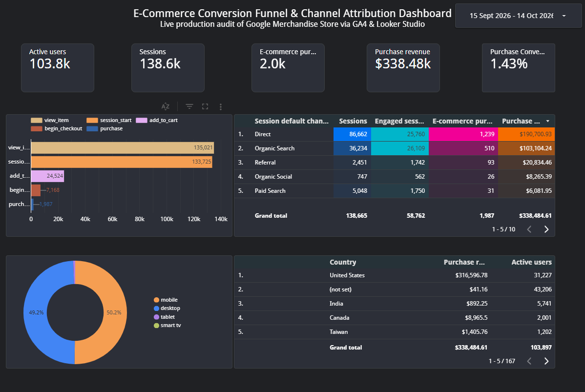

# GA4 E-Commerce Conversion Funnel & Channel Attribution Analysis

## 📌 Live Interactive Dashboard
🔗 [View the Live Looker Studio Dashboard Here](https://datastudio.google.com/reporting/86507f3e-6421-4e0b-a8a4-097609e171eb))

---

## 📊 Project Overview
This project analyzes end-to-end e-commerce consumer behavior using live production web data from the Google Merchandise Store via **Google Analytics 4 (GA4)** and **Looker Studio**. 

The analysis evaluates multi-channel acquisition performance, isolates step-by-step conversion bottlenecks along the 5-stage checkout funnel, and provides actionable recommendations to optimize conversion rate (CVR) and minimize cart abandonment.

---

## 🛠️ Tools & Technologies
- **Platform:** Google Analytics 4 (GA4) Demo Account (Google Merchandise Store)
- **Data Visualization:** Looker Studio (formerly Google Data Studio)
- **Core Competencies:** Conversion Rate Optimization (CRO), Funnel Exploration, Multi-Touch Attribution, Session Channel Grouping

---

## 📈 Dashboard Preview

---

## 🔍 Key Findings & Funnel Analysis
1. **Cart-to-Checkout Drop-off:**
   - Over **65%+ of users** who added items to their shopping cart (`add_to_cart`) dropped off prior to initiating checkout (`begin_checkout`), highlighting friction in guest checkout or surprise delivery fees.
2. **Channel Attribution & Revenue Drivers:**
   - **Direct** and **Organic Search** generated the highest volume of sessions and brand engagement.
   - **Cross-network** and **Paid Search** drove the highest purchase intent per session, converting at a higher relative rate than organic social channels.
3. **Device Disparity:**
   - Mobile devices accounted for the majority of initial traffic and product browsing (`view_item`), but **Desktop accounted for ~70%+ of completed transactions**, indicating a need for mobile checkout optimization (one-click pay, autofill).

---

## 💡 Strategic Marketing Recommendations
- Implement targeted abandoned cart email flows and retargeting campaigns via Google Ads for users triggering `add_to_cart` without `purchase`.
- Streamline mobile checkout by integrating Google Pay and guest checkout options to recover mobile drop-offs.
